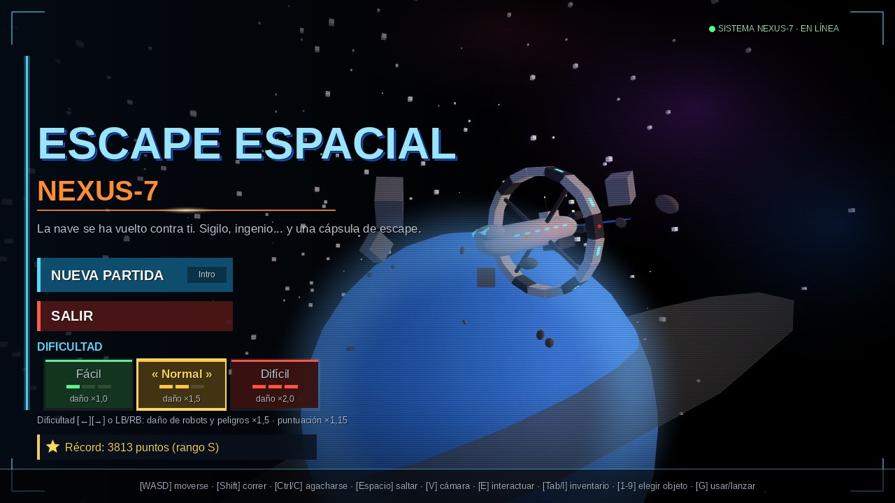
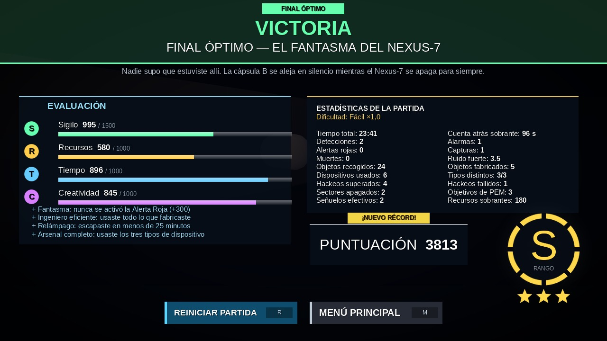

# Escape Espacial: Nexus-7

Juego de **sigilo en primera o tercera persona** hecho en **Unity (C#)**. Despiertas en una nave cuyos robots se han rebelado y tienes que llegar a la cápsula de escape antes de la autodestrucción, sin pelear: escondiéndote, fabricando dispositivos y hackeando sistemas.

> Proyecto académico de Samuel (Ingeniería de Software, Universidad Cooperativa de Colombia, sede Pasto).

## Dónde está cada cosa

```
Assets/_Nexus7/Scripts/   ← todo el código del juego (C#)
docs/guias/fases/         ← guías de las 6 fases originales
Tests/                    ← pruebas automáticas (492 comprobaciones, sin Unity)
docs/guias/mejoras/       ← guías de las mejoras (etapas 0 a 8)
docs/superpowers/         ← diseño (specs) y planes de implementación
docs/media/               ← vídeo de la maqueta y capturas
```

### Código (`Assets/_Nexus7/Scripts`)

| Carpeta | Qué contiene |
|---|---|
| `Player` | Movimiento, salto, cámara 1ª/3ª persona (V), salud, escudo del traje |
| `Characters` | Modelos redondeados generados por código y animación procedural |
| `Enemies` | Patrulla, visión, ataque cuerpo a cuerpo y armas de los robots |
| `Inventory` | Inventario, barra rápida 1–9, botín aleatorio con objetos garantizados |
| `Crafting` | Bancos de trabajo y recetas |
| `Devices` | Señuelo, pulso PEM, camuflaje óptico y kit de reparación |
| `Stealth` | Sombras, ruido y visibilidad del jugador |
| `Security` | Láseres, cámaras, hackeo |
| `Power` | Red eléctrica de la sala de energía |
| `Hazards` | Cables y trampas eléctricas |
| `Interaction` | Puertas, terminales, taquilla del traje, objetos interactivos |
| `Cinematics` | Cinemáticas con subtítulos en español |
| `Gameplay` | Flujo de la partida, alertas, reaparición, finales y puntuación |
| `Core` | Dificultad, sesión de juego y estadísticas |
| `Environment` | Luces, efectos y ambientación |
| `Tutorial` | Tutorial de la fase 1 e intros de nivel |
| `UI` | HUD, menú principal, resultados y paneles |
| `Editor` | Constructores que generan las 6 escenas desde el menú **Nexus-7** de Unity |

## Cómo abrirlo en Unity

El repositorio es un proyecto de Unity completo (**Unity 6000.6.4f1**, URP), con `ProjectSettings/` y `Packages/` incluidos.

1. En **Unity Hub → Proyectos → Añadir → Añadir proyecto desde repositorio**, elige GitHub, el repositorio `moreno-stack/Nexuz-7` y la rama `main`. También puedes clonarlo con git y usar **Añadir proyecto desde disco**.
2. Ábrelo con Unity 6000.6.4f1. La primera vez tarda unos minutos porque Unity crea la carpeta `Library/`, que no se sube a git.
3. Construye las escenas: al abrir el proyecto por primera vez, Unity pregunta si quieres construirlas (pulsa **Construir**). También puedes usar el menú **Nexus-7 → Construir todo el juego (Fases 1–6 y menú)**. Tarda uno o dos minutos y deja abierta la escena `MenuPrincipal`.
4. Pulsa **Play**.

El proyecto ya trae TextMeshPro, los ajustes de URP y *Active Input Handling* en **Both** (teclado, ratón y mando).

## Fases

| Fase | Escena | Enemigos | Objetivo |
|---|---|---|---|
| 1 | Sala inicial | — | Ponerse el traje espacial y salir del corredor |
| 2 | Almacén de carga | Seguridad (bate) | Conseguir 2 baterías para el montacargas |
| 3 | Sala de energía | Guardias (llave inglesa) | Restaurar los 4 bloques de energía |
| 4 | Laboratorio | Investigación (porra eléctrica) | Conseguir la tarjeta del director |
| 5 | Centro de control | Élite (hacha) | Autorizar la compuerta y llegar al puente |
| 6 | Evacuación | Élite + seguridad | Lanzar la cápsula B antes de 5 minutos |

## Controles

| Tecla | Acción |
|---|---|
| W A S D | Moverse |
| Shift | Correr (hace ruido) |
| Ctrl / C | Agacharse |
| Espacio | Saltar · mantener para saltar una cinemática |
| V | Cámara 1ª / 3ª persona |
| E | Interactuar |
| 1–9 / rueda | Elegir objeto de la barra rápida |
| G / clic | Usar o lanzar el dispositivo |
| Tab / I | Inventario |

Dificultad (menú principal): **Fácil ×1,0 · Normal ×1,5 · Difícil ×2,0** de daño.

## Menú y pantalla final





Capturas de previsualización generadas desde el código del proyecto (en Unity la luz y los brillos se ven mejor). Detalles en [`docs/guias/mejoras/GUIA_MEJORAS_ETAPA8.md`](docs/guias/mejoras/GUIA_MEJORAS_ETAPA8.md).

## Pruebas

```bash
bash Tests/run_all.sh
```

Compila todo el código, incluidos los constructores de escena, y ejecuta las 492 comprobaciones con Mono, sin abrir Unity. Los detalles están en [`Tests/README.md`](Tests/README.md).
